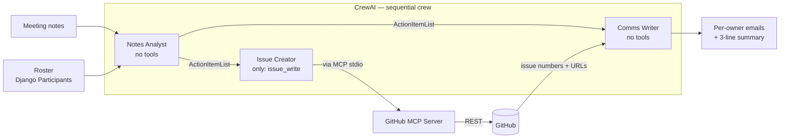

# MeetingCrew

A Django learning project exploring **multi-agent AI (CrewAI)** and the **Model Context Protocol (MCP)**.

Paste meeting notes → a crew of three AI agents extracts action items, opens GitHub issues through the GitHub MCP server, and drafts per-owner follow-up emails.

> Built end-to-end as a hands-on way to learn CrewAI, MCP, and agent orchestration. Not production software.

---

## What it does

Given a block of raw meeting notes and a roster of participants, MeetingCrew:

1. **Extracts** every action item and matches owners strictly against the roster (no hallucinated people).
2. **Creates** one GitHub issue per action item, assigning it to the owner when known.
3. **Drafts** a short email per owner listing only their tasks (with issue links), plus a 3-line meeting summary.

## Architecture



### Stack

| Layer | Choice | Why |
|---|---|---|
| Web app | Django | Admin, ORM, templating — one-stop |
| Agent orchestration | CrewAI | Sequential multi-agent pipeline with structured outputs |
| Tool bridge | `crewai_tools.MCPServerAdapter` | Wraps MCP tools as CrewAI `BaseTool`s |
| External tools | GitHub MCP server | Exposes GitHub as MCP tools (stdio transport) |
| LLM | OpenAI (`gpt-4o-mini`) | Fast, cheap, good at structured outputs |
| Data | SQLite | Keeps the quickstart to zero infra |

### Why only one tool for the Issue Creator?

The GitHub MCP server exposes 30 tools (create repos, delete files, fork, push, etc.). The Issue Creator agent is given **only** `issue_write`. Principle of least privilege: the smaller the agent's capability surface, the smaller the blast radius if a prompt is misread or injected.

## Project layout

```
meetingcrew/
├── manage.py                    Django CLI entrypoint
├── meetingcrew/                 Django project (site-wide config)
│   ├── settings.py              Loads .env via python-dotenv
│   └── urls.py
├── meetings/                    Django app (feature code)
│   ├── models.py                Participant, MeetingRun, ActionItem
│   ├── admin.py                 Models registered for Django admin
│   ├── mcp_client.py            Builds StdioServerParameters for the GitHub MCP server
│   └── crew.py                  The three agents + three tasks + run_meeting_crew()
├── scripts/
│   ├── list_mcp_tools.py        Lists every tool the MCP server exposes
│   └── test_crew.py             End-to-end crew test with sample notes
├── requirements.txt
└── .env                         Secrets (not committed)
```

## Quickstart

### 1. Prereqs
- Python 3.13 (3.14 is too new for the ML/AI package ecosystem as of this writing)
- Go 1.27+ (to build the GitHub MCP server binary)
- A GitHub Personal Access Token with **Issues: read & write** on your target repo
- An OpenAI API key

### 2. Clone and set up
```bash
git clone https://github.com/<you>/meetingcrew
cd meetingcrew
python3.13 -m venv .venv
source .venv/bin/activate
pip install -r requirements.txt
```

### 3. Build the GitHub MCP server
```bash
git clone https://github.com/github/github-mcp-server
cd github-mcp-server
go build -o github-mcp-server ./cmd/github-mcp-server
cd ..
```

### 4. Configure `.env`
```
GITHUB_PERSONAL_ACCESS_TOKEN=ghp_...
GITHUB_MCP_BINARY=/absolute/path/to/github-mcp-server/github-mcp-server
OPENAI_API_KEY=sk-proj-...
OPENAI_MODEL_NAME=gpt-4o-mini
```

### 5. Run Django
```bash
python manage.py migrate
python manage.py createsuperuser    # for /admin
python manage.py runserver
```

Open http://127.0.0.1:8000/admin, add 2–3 **Participants** (name, email, GitHub username, optional aliases).

### 6. Try the crew end-to-end
Edit `scripts/test_crew.py` with your repo and roster, then:
```bash
python scripts/test_crew.py
```

You should see action items extracted, real GitHub issues created in your sandbox repo, and emails drafted in the console.

## Known caveats

- **PAT permissions for assignees:** Fine-grained PATs that can create issues may still fail to **set assignees** on them — GitHub silently drops the field. Give the PAT explicit "Issues: Read and write" scope, or use a classic PAT with `repo`.
- **Agent hallucinations under tool failure:** If an MCP tool call keeps failing, the LLM may fabricate a successful response. We mitigate this by wrapping tools to strip `null`-valued args before the MCP call (see `NullFilteringTool` in `meetings/crew.py`), but it's a general risk — always verify side-effects (like real issue creation) against the external system, not the agent's own claims.
- **Non-determinism:** The Notes Analyst occasionally miscategorizes shared tasks (notes that say "Both"). This can be prompt-tuned.
- **Costs & side-effects:** Running the crew calls OpenAI (burns tokens) and creates real GitHub issues. Test against a sandbox repo you don't mind polluting.

## Roadmap

- [ ] Paste-notes form + results view inside the Django app (replace `scripts/test_crew.py` with a UI).
- [ ] Persist `MeetingRun`s and `ActionItem`s from the crew back to the DB.
- [ ] Actually send the drafted emails (SMTP backend).
- [ ] Simple in-app dashboard: runs over time, success rate, issues created.
- [ ] Prompt-tune the "shared task" case.

## Credits

Built as a learning exercise. The hard parts are standing on the shoulders of:
- [CrewAI](https://github.com/crewAIInc/crewAI) — agent framework
- [GitHub MCP server](https://github.com/github/github-mcp-server) — MCP implementation of the GitHub API
- [Model Context Protocol](https://modelcontextprotocol.io) — the open protocol itself
